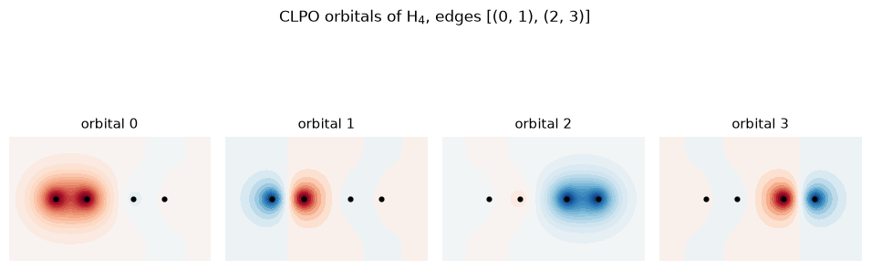

# CLPO – chemically localized orbitals

Builds molecules in **localized orbital bases** that look like the chemist's picture of bonds and lone pairs:
- **HAO** – hybrid atomic orbitals (sp, sp², sp³-like hybrids on each atom).
- **CLPO** – chemically localized pair orbitals: bonding/antibonding pairs built from the HAOs.

Because each bond becomes an orbital *pair*, CLPOs also give a natural graph of **edges** to use in pair ansätze such as SPA ([Kottmann & Aspuru-Guzik, PRA 2022](https://doi.org/10.1103/PhysRevA.105.032449)). The localization is done with [JANPA](https://janpa.sourceforge.net/) ([Nikolaienko et al., Comput. Theor. Chem. 2014](https://doi.org/10.1016/j.comptc.2014.10.002)); CLPOs are introduced in [Nikolaienko & Bulavin, Int. J. Quantum Chem. 2019](https://doi.org/10.1002/qua.25798) through a PySCF or Psi4 interface.

<p align="center"></p>

*CLPOs of a stretched H₄ chain: each bond (0,1) and (2,3) gets a bonding and an antibonding orbital, giving the SPA edges `[(0, 1), (2, 3)]`.*

| Function | Returns |
|---|---|
| `generate_HAO_molecule(mol)` | molecule in HAO basis |
| `generate_CLPO_molecule(mol)` | molecule in CLPO basis |
| `generate_CLPO_molecule_edges(mol, edges=None)` | molecule + suggested SPA edges |

```python
import sunrise as sn
from sunrise.CLPO import generate_CLPO_molecule_edges

mol = sn.Molecule(geometry="N 0 0 0\nN 0 0 1.098", basis_set="sto-3g", backend="pyscf")
mol, edges = generate_CLPO_molecule_edges(mol)
U = mol.make_ansatz("HCB-SPA", edges=edges)
sn.plot_MO(mol, filename="N2_CLPO")   # look at the orbitals
```

**See also:** [CLPO example](../../../examples/CLPO_orbitals/clpo_example.py) · [HAO example](../../../examples/Hybrid_Atomic_Orbitals/HAO.py)
