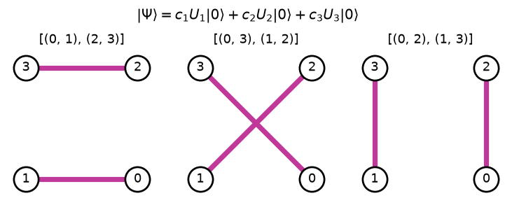

# MCVBT – multi-configurational valence bond theory

A single pair-ansatz circuit (e.g. SPA) describes one "bonding pattern" of a molecule. MCVBT combines **several graphs** (several valence-bond structures, like resonance structures) into one wavefunction

32469|\Psi\rangle = \sum_k c_k\, U_k |0\rangle32469

and finds the coefficients $c_k$ by solving a small generalized eigenvalue problem (`gem.py`) built from the overlaps and Hamiltonian matrix elements between the circuits (`big_exp.py`).

```python
import sunrise as sun
from sunrise.MCVBT.gnm import mcvbt

mol = sun.chemistry.Molecule(
    geometry="H 1.5 0 0\nH 0 0 0\nH 1.5 0 1.5\nH 0 0 1.5", basis_set="sto-6g"
).use_native_orbitals()
graphs = [[(0, 1), (2, 3)], [(0, 3), (1, 2)], [(0, 2), (1, 3)]]
solver = mcvbt(mol=mol, graphs=graphs, solver="qulacs")
solver.calculate_groundstate()
solver.compare_to_fci()
```

<p align="center"></p>

*The three H₄ graphs of the snippet: each one is an SPA circuit $U_k$, and MCVBT mixes them like resonance structures.*

Results are also written to a CSV file (`filename=`).

**Background:** [Kottmann & Scala, *Quantum Algorithmic Approach to Multiconfigurational Valence Bond Theory: Insights from Interpretable Circuit Design*, JCTC 2024](https://doi.org/10.1021/acs.jctc.3c00565) · **See also:** [example](../../../examples/MCVBT/MCVBT_example.py)
