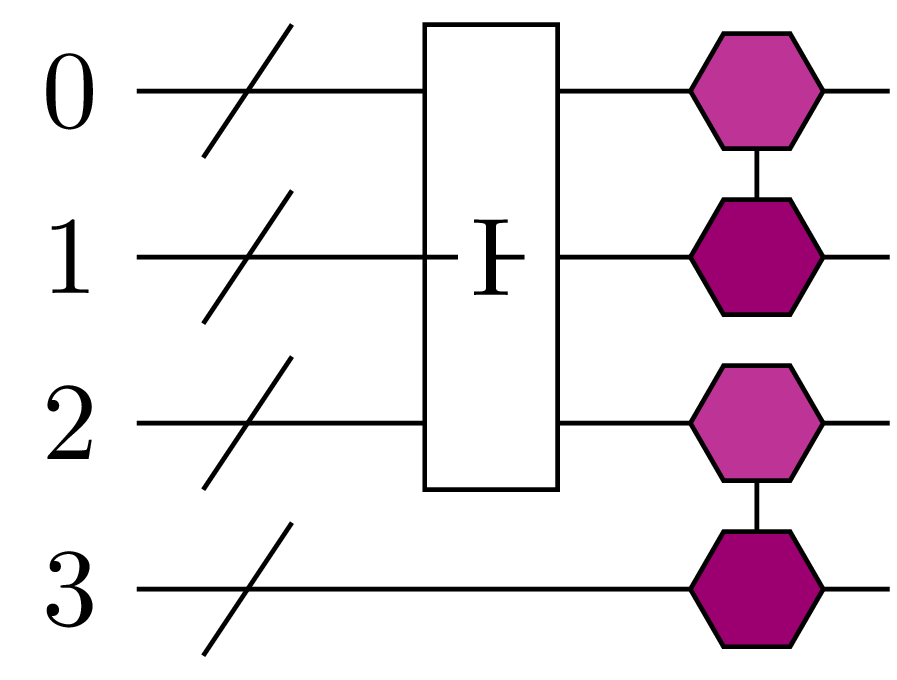
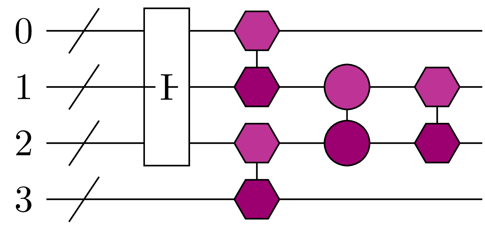

# fermionic_operations – fermionic circuits

Circuits written directly in terms of **fermionic gates** on spatial/spin orbitals, without fixing a qubit encoding. This keeps circuits compact and lets them run on fermionic simulators (see [`expval`](../expval)).

**Gates**
- `FermionicExcitation` – generic excitation $e^{-i\theta/2 (a^\dagger_p a_q - h.c.)}$
- `UR(i, j)` – orbital rotation between spatial orbitals *i, j* (a Givens rotation)
- `UC(i, j)` – pair (electron-pair) excitation between *i, j*
- `UX`, `Givens`, `Phase`
- `FCircuit` – container; `FCircuit.from_edges(n_orb, edges)` builds an SPA-type circuit.

<p align="center"></p>

*`FCircuit.from_edges(n_orb=4, edges=[(0, 1), (2, 3)])` drawn with [`sunrise.graphical`](../graphical): reference state, then one pair excitation (hexagons) per edge.*

Orbital rotations can be compiled into Givens-rotation networks (`givens_rotations.py`), following [Kivlichan et al., PRL 2018](https://doi.org/10.1103/PhysRevLett.120.110501).

```python
import sunrise as sn
from sunrise.fermionic_operations import UR, UC

U = sn.FCircuit.from_edges(n_orb=4, edges=[(0, 1), (2, 3)])
U += UR(1, 2, "a") + UC(1, 2, "b")
print(U)
```

<p align="center"></p>

*Circuit from the snippet: SPA pair excitations on (0,1) and (2,3), then an orbital rotation `UR(1, 2)` (circles) and a pair excitation `UC(1, 2)` (hexagons).*

**See also:** [Givens rotation example](../../../examples/givens_rotation/givens_rotation.py) · [orbital rotator tests](../../../tests/test_Orbital_Rotator.py)
