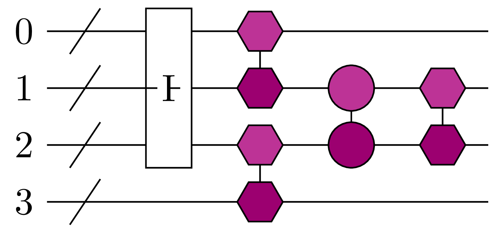

# fermionic_operations – fermionic circuits

Circuits written directly in terms of **fermionic gates** on spatial/spin orbitals, without fixing a qubit encoding. This keeps circuits compact and lets them run on fermionic simulators (see [`expval`](../expval)).

**Gates**
- `FermionicExcitation` – generic excitation $e^{-i\frac{\theta}{2} G}$ with $G = i(\prod_k a^\dagger_{q_k} a_{p_k} - \mathrm{h.c.})$ for the pairs $(p_k, q_k)$
- `UR(i, j)` – orbital rotation between spatial orbitals *i, j* (a Givens rotation)
- `UC(i, j)` – pair (electron-pair) excitation between *i, j*
- `UX`, `Givens`, `Phase`
- `FCircuit` – container; `FCircuit.from_edges(n_orb, edges)` builds an SPA-type circuit.

An `FCircuit` has an `initial_state` (a tequila `QubitWaveFunction`, checked to conserve the particle number) and its gates.
The initial state can be given as a string such as `"1*|11001100>"`, an array, an `FCircuit` or `QCircuit` without free variables, or anything `QubitWaveFunction.convert_from` accepts.
**It must be in up-then-down ordering (reordered Jordan-Wigner)**, the format of the fermionic backends.
Without one, the backends start from Hartree-Fock. `U.to_qcircuit(mol)` compiles the circuit to a tequila `QCircuit` for a qubit molecule.

```python
import sunrise as sun
from sunrise import gates

U = sun.FCircuit()
U.initial_state = "1*|11001100>"  # up-then-down: orbitals 0 and 1 doubly occupied
U += gates.UR(0, 1, "a") + gates.UR(2, 3, "b")
U += gates.UC(1, 2, "c") + gates.UC(0, 3, "d")
U += gates.FermionicExcitation(
    [(0, 4), (1, 5)], "e"
)  # interleaved indices: pair from orbital 0 to 2
```

Orbital rotations can be compiled into Givens-rotation networks (`givens_rotations.py`), following [Kivlichan et al., PRL 2018](https://doi.org/10.1103/PhysRevLett.120.110501).

```python
import sunrise as sun
from sunrise.fermionic_operations import UR, UC

U = sun.FCircuit.from_edges(n_orb=4, edges=[(0, 1), (2, 3)])
U += UR(1, 2, "a") + UC(1, 2, "b")
print(U)
```

<p align="center"></p>

*Circuit from the snippet, drawn with [`sunrise.graphical`](../graphical): SPA pair excitations on (0,1) and (2,3), then an orbital rotation `UR(1, 2)` (circles) and a pair excitation `UC(1, 2)` (hexagons).*

**See also:** [Givens rotation example](../../../examples/givens_rotation/givens_rotation.py) · [orbital rotator tests](../../../tests/test_Orbital_Rotator.py)
