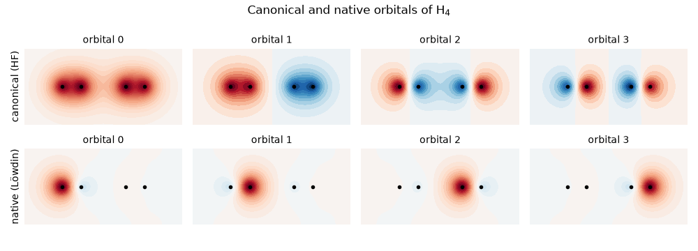
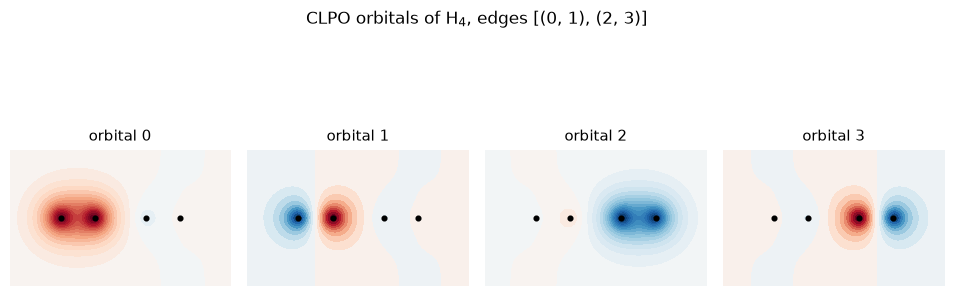
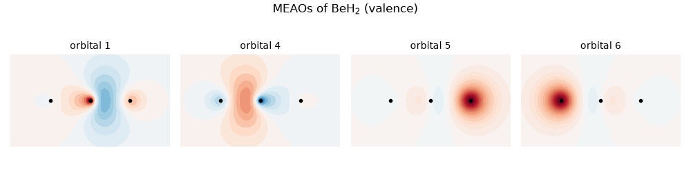

# orbital_transformations – orbital bases of a molecule

Builds molecules in other orbital bases than the canonical Hartree-Fock ones. Each basis lives in its own subpackage and is available as a molecule method for all natures, and by name through `mol.use_orbitals`:

| Subpackage | Orbitals | Molecule method | `use_orbitals` name |
|---|---|---|---|
| `loewdin` | native (Löwdin, orthonormalized atomic) orbitals | `use_native_orbitals()` | `"loewdin"` or `"native"` |
| `CLPO` | Chemist's Localized Property-optimized Orbitals and hybrid atomic orbitals | `use_CLPO_orbitals()`, `use_HAO_orbitals()` | `"CLPO"`, `"HAO"` |
| `MEAO` | maximally entangled atomic orbitals | `use_MEAO_orbitals()` | `"MEAO"` |

`use_orbitals` passes keyword arguments on to the method:
```python
import sunrise as sun

mol = sun.Molecule(geometry="H 0 0 0\nH 0 0 0.7", basis_set="sto-3g")
mol = mol.use_orbitals("loewdin")  # same as mol.use_native_orbitals()
mol = mol.use_orbitals("CLPO", edges=[(0, 1)])  # keywords go to use_CLPO_orbitals
```

## loewdin – native orbitals

The **native orbitals** are the atomic basis functions, symmetrically (Löwdin) orthonormalized. For standard basis sets these are the orthonormalized Gaussian basis functions, so each orbital stays centered on its atom. With a frozen core, the active native orbitals are those with the smallest overlap with the core orbitals. For hybrid molecules the F/B selection is carried over to the new orbitals, so check that it is still what you want.

<p align="center"></p>

*Canonical and native orbitals of a stretched H₄ chain: the canonical orbitals spread over the whole chain, the native ones sit on one atom each.*

| Function | Returns |
|---|---|
| `generate_loewdin_molecule(mol, core=None, active=None)` | molecule in native basis, of the same nature as `mol` |
| `get_native_coefficients(integral_manager)` | coefficients of the native orbitals, $S^{-1/2}$ |
| `transform_to_native_orbitals(integral_manager)` | nothing, puts the native orbitals into the integral manager (no core or active space) |
| `orthogonalize(c, s)` | Löwdin-orthonormalized orbital coefficients |
| `orthogonalize_active_space(c, s, frozen_idx, active_idx)` | coefficients with the active orbitals orthonormalized against the frozen ones |
| `get_active`, `get_core` | the native orbitals that best span the active space, or the orbitals to freeze |
| `transform(modified, original)` | molecule with the orbitals of `modified` as active space and those of `original` as core, + the map of the active orbitals |

```python
mol = sun.Molecule(geometry="H 0 0 0\nHe 0 0 1.5\nH 0 0 3.0", basis_set="sto-3g")
mol = mol.use_native_orbitals(core=[0])  # active: the 1s orbitals of the two H
```

## CLPO – localized orbitals of bonds and lone pairs

Localized orbital bases that look like the chemist's picture of bonds and lone pairs:
- **HAO** – hybrid atomic orbitals (sp, sp², sp³-like hybrids on each atom).
- **CLPO** – Chemist's Localized Property-optimized Orbitals: bonding/antibonding orbitals and lone pairs built from the HAOs.

Because each bond becomes an orbital *pair*, CLPOs also give a natural graph of **edges** to use in pair ansätze such as SPA ([Kottmann & Aspuru-Guzik, PRA 2022](https://doi.org/10.1103/PhysRevA.105.032449)). The localization is done with [JANPA](https://janpa.sourceforge.net/) ([Nikolaienko et al., Comput. Theor. Chem. 2014](https://doi.org/10.1016/j.comptc.2014.10.002)); CLPOs are introduced in [Nikolaienko & Bulavin, Int. J. Quantum Chem. 2019](https://doi.org/10.1002/qua.25798) through a PySCF or Psi4 interface.

<p align="center"></p>

*CLPOs of a stretched H₄ chain: each bond (0,1) and (2,3) gets a bonding and an antibonding orbital, giving the SPA edges `[(0, 1), (2, 3)]`.*

| Function | Returns |
|---|---|
| `generate_HAO_molecule(mol)` | molecule in HAO basis |
| `generate_HAO_molecule_edges(mol)` | molecule in HAO basis + the SPA edges on the HAOs: `(hybrid, H)` for each bond, `(hybrid,)` for each lone pair |
| `generate_CLPO_molecule(mol)` | molecule in CLPO basis |
| `generate_CLPO_molecule_edges(mol, edges=None)` | molecule in CLPO basis + the orbital pairs of each bond, to use as SPA edges (`edges` imposes bonds between atoms, the others come from the atom connectivity) |

The same is available as molecule methods for all natures: `mol.use_HAO_orbitals()`, `mol.use_HAO_orbitals_and_edges()`, `mol.use_CLPO_orbitals()`, `mol.use_CLPO_orbitals_and_edges()` and `mol.get_spa_edges()`.

```python
from sunrise.orbital_transformations.CLPO import generate_CLPO_molecule_edges

mol = sun.Molecule(geometry="N 0 0 0\nN 0 0 1.098", basis_set="sto-3g", backend="pyscf")
mol, edges = generate_CLPO_molecule_edges(mol)
U = mol.make_ansatz("HCB-SPA", edges=edges)
sun.plot_MO(mol, filename="N2_CLPO")  # look at the orbitals
```

## MEAO – maximally entangled atomic orbitals

**Maximally entangled atomic orbitals** (MEAO, [Ding, Matito & Schilling, arXiv 2025](https://arxiv.org/abs/2501.15699)) are atom-centered orbitals defined through orbital entanglement. They are optimized in the space of the intrinsic atomic orbitals (IAOs) of the Hartree-Fock occupied orbitals, with the original [MEAO](https://github.com/schilling-group/MEAO) code through PySCF. MEAO is not installed with sunrise:
```bash
pip install "MEAO @ git+https://github.com/schilling-group/MEAO"
```

<p align="center"></p>

*Valence MEAOs of BeH₂ (example below): two Be hybrids (1, 4), each pointing at one H, and the H 1s orbitals (5, 6). The Be 1s core (0) and the Be 2p perpendicular to the bond axis (2, 3) are not shown.*

| Function | Returns |
|---|---|
| `generate_MEAO_molecule(mol, minao="minao")` | molecule in MEAO basis; for basis sets larger than `minao` the MEAOs are completed by their orthonormal complement |

The same is available as molecule method for all natures: `mol.use_MEAO_orbitals()`. With a frozen core (the default) the core MEAOs are replaced by the canonical core orbitals; use `frozen_core=False` to get exactly the orbitals of the original code.

```python
mol = sun.Molecule(geometry="Be 0 0 0\nH 0 0 1.3\nH 0 0 -1.3", basis_set="sto-3g")
mol = mol.use_MEAO_orbitals(minao="sto-3g")  # PySCF's "minao" has no p shell on Be
sun.plot_MO(mol, filename="BeH2_MEAO")  # look at the orbitals
```

**See also:** [CLPO example](../../../examples/CLPO_orbitals/clpo_example.py) · [HAO example](../../../examples/Hybrid_Atomic_Orbitals/HAO.py) · [tests](../../../tests/test_chemistry.py)
